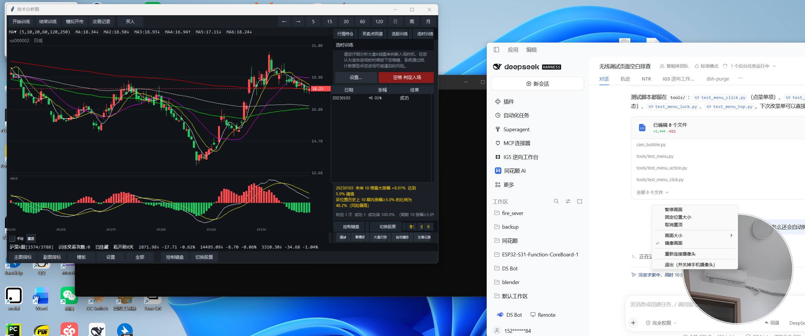

# Cam Bubble — 手机前置摄像头实时圆形浮窗

把 Android 手机的前置摄像头画面，实时显示成 Windows 桌面上一个**永远置顶的圆形浮窗**；
浮窗可以用**滚轮自由缩放**、左键拖动，右键菜单里能暂停 / 固定 / 取消置顶 / 换尺寸 / 重连 / 退出。



> 实测环境：Redmi K20 Pro（Android 11 / MIUI 12.5，Magisk root）+ Windows 11，2752×1152@125%
> 实测指标：640×480、**20~21 fps**、首帧约 0.10s、局域网 Wi-Fi

## 特性

- **不装第三方 App**：手机端是本仓库现编的 20 KB `CamStream.apk`，只做「开前置摄像头 → 推 MJPEG」
- **圆外真透明**：Win32 分层窗口 + 预乘 alpha（不是抠色），圆外的桌面完全不受影响
- **永远置顶**：`WS_EX_TOPMOST`，可随时在菜单里取消/恢复
- **真·相机变焦**：滚轮直接调手机相机的 `setZoom`（0~99 档，约 1x→2x），到顶再自动接 PC 端裁切，最多约 8x；触控板双指捏合也行
- **滚轮改大小**：`Ctrl+滚轮` 以圆心为基准 ±20px/格，尺寸和位置自动记到 `cam_bubble.cfg.json`
- **右键菜单**：暂停/继续、固定位置大小、取消/恢复置顶、画面大小子菜单、镜像、重连、退出
- **双层看门狗**：手机端相机被系统收走会自动重开；PC 端发现断流会自动重启 App
- **重启自愈**：手机重启 ~30s 自动恢复（adb 走 `IP:5555`、自动解锁、重开相机）；PC 重启用 `tools/autostart.ps1` 装开机自启
- **退出是真的退出**：点退出会关掉手机摄像头，并通知看门狗一起收工，不会自己弹回来

### 需要一直插着 USB 吗？

**不用。** 视频走局域网 MJPEG（`http://手机IP:8088/video`），adb 也能走「无线调试」，两头都不依赖线：

| 情况 | 表现 |
|---|---|
| 无线调试开着（默认） | 全程无线：取流 + adb 都走 Wi-Fi，插一次线都不需要留 |
| 无线调试关了、只插 USB | 也能跑：脚本自动 `adb forward tcp:18088 tcp:8088`，把手机端口隧道到本机 |
| 两条都在 | 优先 Wi-Fi；**拔线后自动切到无线**（serial 会重新解析，不会因为 USB 没了而报错） |
| 两条都没有 | 起不来 —— 至少要有其中一条 |

> 唯一必须插线的时候：第一次开「无线调试」要配对码，或者手机重启后无线调试被关掉、需要重新打开。

## 快速开始

```powershell
# 1) 准备（一次性）
#    - 手机开「无线调试」并配对，或直接插 USB（详见 docs/DEVICE-SETUP.md）
#    - 目录里放好运行时二进制（见下方"依赖"）
# 2) 编译手机端 APK（可选，dist/ 里已有编好的）
.\build_apk.ps1
# 3) 一键启动
.\启动摄像头浮窗.bat        # 等价于 .\camera_live.ps1 -Source apk -Size 380 -Watch
```

运行中：

| 操作 | 效果 |
|---|---|
| 滚轮上/下 | **变焦**（放大/缩小，手机相机档位 + PC 裁切） |
| Ctrl + 滚轮 | 圆形直径 ±20px（圆心不动） |
| 触控板双指捏合 | 变焦（同上） |
| 左键拖动 | 移动位置 |
| 右键 | 打开菜单 |

## 目录结构

```
.
├─ cam_bubble.py          # 浮窗本体（纯 ctypes + Pillow + numpy，无 GUI 框架依赖）
├─ camera_live.ps1        # 一键编排：连 adb → 装/启 CamStream → 起浮窗 → 校验 → 看门狗
├─ wait_phone.ps1         # 挂机等手机上线，连上就自动启动
├─ build_apk.ps1          # 编译 android/ 下的 CamStream.apk
├─ 启动摄像头浮窗.bat       # 双击入口
├─ android/
│  ├─ AndroidManifest.xml
│  ├─ debug.keystore      # 调试签名（密码 android / 别名 androiddebugkey）
│  └─ src/dev/local/camstream/MainActivity.java
├─ dist/camstream.apk     # 预编译好的手机端 APK（v1.1，自带 /zoom 变焦接口）
├─ docs/
│  ├─ ARCHITECTURE.md     # 数据链路、浮窗实现、看门狗与退出协议
│  ├─ USAGE.md            # 参数、菜单、状态文件
│  ├─ DEVICE-SETUP.md     # 手机侧准备 & MIUI 白名单
│  ├─ TROUBLESHOOTING.md  # 踩过的所有坑
│  └─ images/
└─ tools/                 # 辅助脚本 + 运行时二进制（二进制已 gitignore）
```

## 依赖

| 依赖 | 用途 | 说明 |
|---|---|---|
| Python 3.10+ | 跑浮窗 | 需要 `Pillow`、`numpy` |
| JDK 8+ | 编 APK | `javac` / `keytool` / `java` 在 PATH |
| `tools/android/android-14` | build-tools | aapt2 / d8 / zipalign / apksigner |
| `tools/android/android-11/android.jar` | 编译平台包 | Android 11 |
| `tools/scrcpy-win64-v5.0.1/adb.exe` | adb | 只用它的 adb（版本自洽即可） |
| `tools/ffmpeg/ffmpeg.exe` | 备选路线 | 仅 `-Source adb`（录屏解码）时需要 |

`tools/` 下的三个大目录不入库，按上表自行放置。

## 原理一句话

```
手机前置相机 (Camera1) → JPEG → HTTP MJPEG :8088
   → PC：转 90° → 居中裁方 → 圆形遮罩(4×超采样) → 预乘 alpha → WS_EX_LAYERED 分层窗口 → 置顶
```

细节见 [docs/ARCHITECTURE.md](docs/ARCHITECTURE.md)。

## 文档

- [架构与实现](docs/ARCHITECTURE.md)
- [使用手册](docs/USAGE.md)
- [手机侧准备（含 MIUI 白名单）](docs/DEVICE-SETUP.md)
- [重启稳定性（实测）](docs/DURABILITY.md)
- [排坑记录](docs/TROUBLESHOOTING.md)

## License

[MIT](LICENSE)
